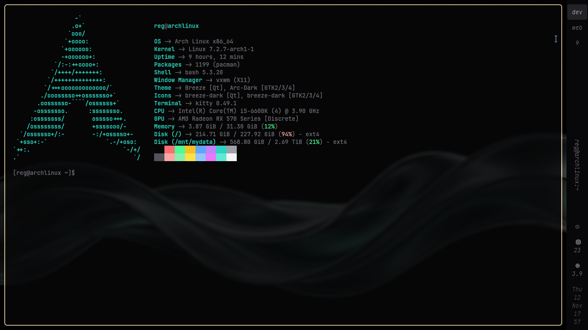
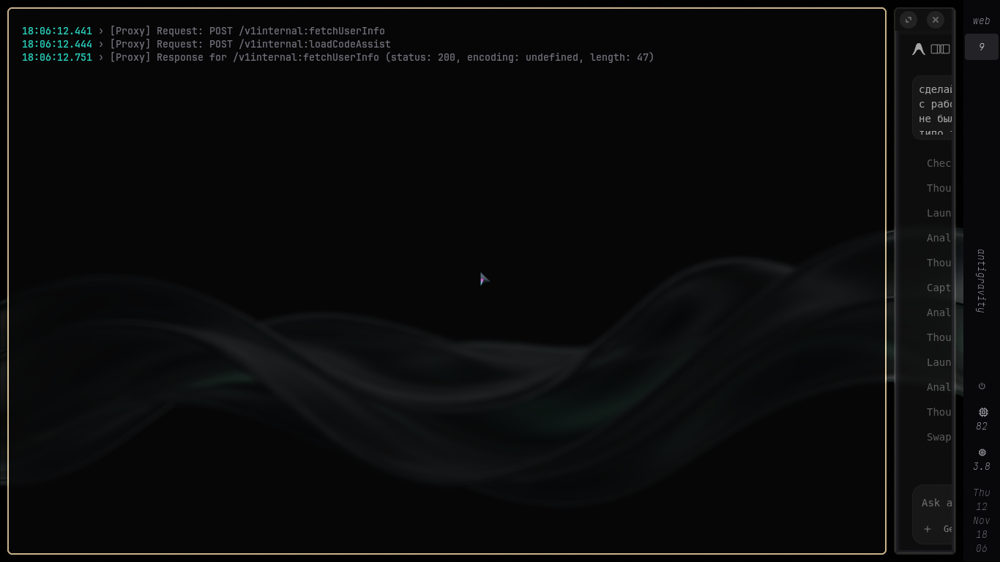
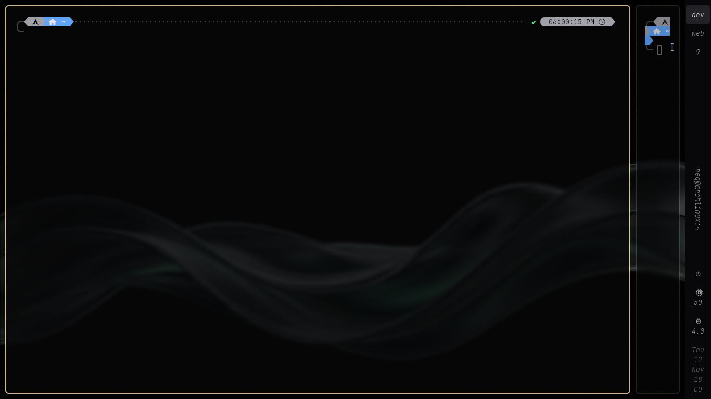
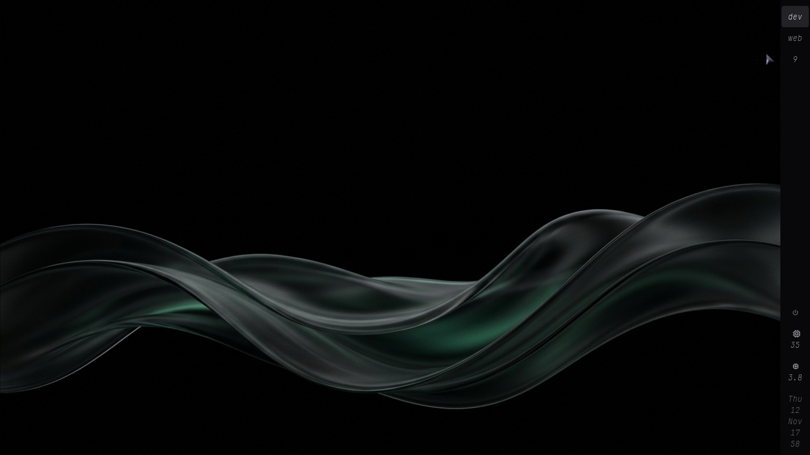

# 📸 Галерея скриншотов Load of Reger

Рабочий стол, тайлинг окон, кастомный бар vxbar и окружение сессии в действии.

---

### 1. Рабочий стол и Fastfetch
Чистый рабочий стол с активной темой, системным баром `vxbar` и терминалом Kitty с выводом `fastfetch`.

---

### 2. Тайлинг окон и терминал
Автоматический тайлинг в vxwm: отображение терминала Kitty с настроенными отступами (gaps) и рамками окон.

---

### 3. Сплит окон и разделение рабочей области
Разделение экрана между окнами (вертикальный и горизонтальный сплит с сохранением пропорций).

---

### 4. Рабочее пространство с окнами (Обзор 1)
Многооконный режим работы, размещение приложений на бесконечном холсте и переключение тегов.

---

### 5. Рабочее пространство с окнами (Обзор 2)
Внешний вид шрифтов JetBrains Mono Nerd, зазоров и теней композитора `picom`.

